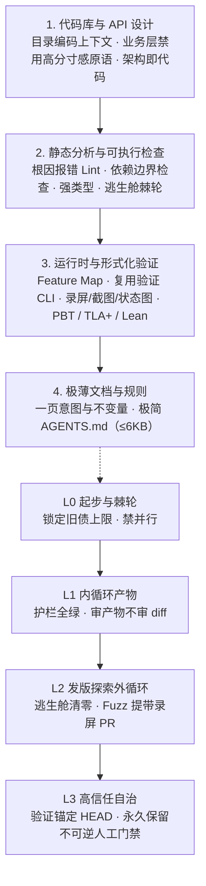

# General Workflow v2

一套以**代码库护栏与行为产物**为核心的 Agent 开发工作流（灵感来自 Lauren Tan《All Code Is Slop (Except Mine)》的信任倒金字塔与软件工厂实践）。

它不再让 Agent 靠“读 18 份流程书、维护切片台账锁”推进，而是把约束直接写进目标仓库的**目录结构、防呆 API、自定义 Lint、逃生舱棘轮与可复用验证通道**——先让单次内循环可靠到不需逐行审 diff，再按阶梯放开外循环探索与自动合入。

## 为什么从 v1 彻底改版到 v2

| 维度 | 旧版 v1.10.1（`archive/`） | 新版 v2.0（当前主线） |
| --- | --- | --- |
| **控制杠杆** | 管“过程”：11 阶段门禁 + 切片认领锁 + 状态台账 | 管“环境”：目录即上下文、防呆 API、自定义 Lint 与边界检查 |
| **纠错沉淀** | 默认补充阶段文档或模块 `AGENTS.md` | **倒金字塔**：先改 API → 写根因 Lint → 除草 → 补验证 → 最后才写 `AGENTS.md` |
| **旧坏代码** | 严禁顺手重构，偏冻结现状 | 常规需求禁顺手重构无关代码（入停放区）；加规则或重复错 ≥ 2 次时用棘轮与安全除草收敛 |
| **完成证据** | 一行 `<调用> → <结果> @ <commit>` | 用户视角 **Feature Map** + **复用型验证 CLI** + 非空行为产物 + 当前 `HEAD` 新鲜度 |
| **外循环** | 人工按阶段逐项把关 | `L0`–`L3` 成熟度阶梯：内循环高信任后再启发版 Fuzzing 与低风险自动合入 |

## 信任倒金字塔与工作循环



## 仓库结构

```text
.
├── SKILL.md                             # 常驻入口：倒金字塔、五条原则、五条工作循环、Reference Map
├── AGENTS.md                            # 维护本仓库的规则、校验命令与体积预算
├── agents/openai.yaml                   # Codex 入口元数据
├── references/                          # 按需加载：核心流程 + 01a~01e 架构与条件深化
│   ├── 00-router.md                     # 常驻路由：调用 repo_guard.py、选 reference、全局停止条件
│   ├── 01-intent-and-invariants.md      # 一页意图与不变量 + Frontier Grill 追问 + GLOSSARY + 旧仓起步
│   ├── 01a-stack-and-architecture.md    # 入口闸、技术栈计分卡（含 AI 承载度）、深模块与 ARCHITECTURE.md
│   ├── 01b-dataflow-and-contracts.md    # 状态 SSOT、数据流图、代码级 API 契约、上限矩阵与 --check-arch 交接
│   ├── 01c-distributed-and-sync.md      # [条件] 多存储 Outbox、幂等键、Fencing Token 与兼容演进
│   ├── 01d-high-assurance-bounds.md     # [条件] 账务守恒、读写边界成对断言与静态上限封顶
│   ├── 01e-client-state-flow.md         # [条件] 客户端四类状态解交织、纯 Reducer 状态机与回滚语义
│   ├── 02-codebase-guardrails.md        # 目录即上下文、防呆原语、根因 Lint、注释与逃生舱策略
│   ├── 03-verification-and-artifacts.md # Feature Map、验证 CLI、行为产物与新鲜度门禁、PBT/形式化
│   ├── 04-correction-and-gardening.md   # 倒金字塔纠错五步梯、主动除草与棘轮、AGENTS.md 瘦身
│   ├── 05-outer-loop-factory.md         # L0–L3 成熟度阶梯、不可逆人工门禁、回退率与体验指标
│   └── 06-repo-guard-contract.md        # .guardrails/ 契约、--check-arch / repo_guard.py 用法与 v1 迁移
├── scripts/
│   ├── check_consistency.py             # 校验本 skill 仓库、预算与 vendor 校验和
│   ├── repo_guard.py                    # 随 skill 分发；提供 --scan/--init 冷启动、护栏与产物校验
│   ├── install.py                       # 跨工具安装脚本：同步 general-workflow 与内置 pstack 技能
│   └── sync_vendor.py                   # 校验或按固定提交 SHA 同步 vendor/pstack/
├── vendor/
│   └── pstack/                          # Lauren Tan pstack (v0.15.46 @ aaeb0ea, MIT) 原样内置包
│       ├── LICENSE
│       ├── UPSTREAM.json                # 锁定上游提交、技能清单与 84 份文件 LF SHA-256 校验和
│       ├── agents/comment-sicko.md
│       └── skills/                      # 13 个核心执行技能 + 24 个原则技能 + 10 份 Playbook/参考
├── examples/                            # 三个可直接跑通的目标项目示例
│   ├── clean-app/                       # L1 内循环：零逃生舱、边界规则、验证 CLI 与产物
│   ├── weeding-brownfield/              # L0 旧仓起步：clean_scopes 保护新模块 + 棘轮锁定历史债务
│   └── verify-skill-app/                # L1 分片验证 Skill：verify_skill 替代单表 feature-map.md
├── tests/
│   ├── test_check_consistency.py        # 一致性校验器回归测试、预算与 vendor 契约钉死
│   ├── test_repo_guard.py               # repo_guard.py 护栏、verify_cli、clean_scopes 与新鲜度测试
│   ├── test_install.py                  # install.py 与 sync_vendor.py 跨工具（含 pi）安装/卸载测试
│   └── test_examples.py                 # 对 examples/ 真跑脚本并与 README 逐行对齐
└── archive/                             # 只读历史快照，不属于安装包
    ├── general-workflow-v0.12.0/
    └── general-workflow-v1.10.1/
```

## 内置 `pstack` Vendor 技能包

本仓库依据 MIT 协议在 [`vendor/pstack/`](vendor/pstack/UPSTREAM.json) 原样内置了 Lauren Tan（`@poteto`）[`cursor/plugins` 的 `pstack`](https://github.com/cursor/plugins/tree/main/pstack)（`v0.15.46`，锁定提交 `aaeb0ea`），由 [`00-router.md`](references/00-router.md) 按需调度，并在安装时可选一并展开为独立同级 Skill：

- **13 个核心执行技能（默认安装 `--vendor-mode core`）**：`correct`（历史错例聚类与旧错例证伪）、`no-comments`（借口注释猎杀）、`architect`（写前两方案对比）、`why`（提交与 PR 追溯）、`reflect`（复盘反思与结构化沉淀）、`recall`（历史经验检索）、`unslop`（短句直陈去 AI 腔）、`benchmark-checklist`（七问核验基准/性能数字）、`create-verification-skill` / `maintain-verification-skill`（生成与巡检分片 `verify-<app>`）、`create-formal-verification-skill` / `maintain-formal-verification-skill`（形式化验证与同步）、`statechart`（TLA+ 检测与 Mermaid 状态图生成）。
- **24 个原则参考技能（`--vendor-mode all` 一并安装）**：完整纳入上游全部 `principle-*` 原则（含原 12 条及新增 `principle-attack-the-premise`、`principle-build-the-lever`、`principle-exhaust-the-design-space`、`principle-experience-first`、`principle-explain-the-number`、`principle-foundational-thinking`、`principle-make-operations-idempotent`、`principle-minimize-reader-load`、`principle-model-the-domain`、`principle-never-block-on-the-human`、`principle-outcome-oriented-execution`、`principle-separate-before-serializing-shared-state`）。
- **随主技能内置的 10 份 `poteto-mode` Playbook/参考**：`bug-fix.md`、`perf-issue.md`、`refactoring.md`、`prototype.md`、`runtime-forensics.md`、`trace-forensics.md`、`visual-parity.md`、`eval.md`、`hillclimb.md` 与 `references/bugbot-triage.md`（由 `00-router.md` 做跨端屏蔽适配与按需调度，随主技能打包，不展开为独立同级 Skill）。
- **独立审查 Agent**：`agents/comment-sicko.md`（安装到 Claude/Cursor 的 `agents/` 目录；在 Codex 等无命名子 Agent 的环境中作为子 Agent 提示词使用）。

## 目标项目里会出现什么

废除 `docs/workflow/slices/` 台账，只在目标仓库根目录保留三份极轻的 `.guardrails/` 文件（下面截自 [`examples/clean-app/`](examples/clean-app/)）：

```json
<!-- .guardrails/config.json -->
{
  "guardrails_version": 2,
  "trust_level": "L1",
  "check_command": "python -X utf8 -B -m unittest discover -s tests -p \"test_*.py\"",
  "verify_cli": "python -X utf8 tools/verify.py",
  "source_roots": ["src"],
  "exclude_dirs": [".git", "__pycache__", "node_modules", ".venv", ".guardrails"],
  "prose_files": ["AGENTS.md"],
  "prose_max_bytes": 6000,
  "require_fresh_head": false,
  "escape_hatches": {
    "max_allowed": 0,
    "extra_patterns": []
  },
  "forbidden_primitives": [
    {
      "id": "no-raw-sleep",
      "pattern": "\\btime\\.sleep\\s*\\(",
      "globs": ["src/**/*.py"],
      "allow_paths": ["src/runtime"],
      "message": "业务逻辑不要直接调用 time.sleep；请改用 src/runtime/clock.py 的 pause_briefly。"
    }
  ],
  "boundary_rules": [
    {
      "id": "ui-no-direct-storage",
      "from_dir": "src/ui",
      "forbid_import": "core/storage",
      "message": "src/ui 不得直接导入 core/storage；请通过 src/core/api.py 的 OrderService 调用用例。"
    }
  ]
}
```

```markdown
<!-- .guardrails/feature-map.md -->
# Feature Map

| Feature | Entrypoint | Verify CLI | Artifact | Priority |
| --- | --- | --- | --- | --- |
| 导出订单报表 | `python -X utf8 -m src.ui.cli export` | `python -X utf8 tools/verify.py export` | `artifacts/export-csv.txt` | core |
| 重复导出幂等保护 | `python -X utf8 -m src.ui.cli export --batch <key>` | `python -X utf8 tools/verify.py state-chart` | `artifacts/state-chart.md` | core |
| 查看已导出批次摘要 | `python -X utf8 -m src.ui.cli summary` | `python -X utf8 -m src.ui.cli summary` | `artifacts/export-csv.txt` | secondary |
```

```markdown
<!-- .guardrails/verification.md -->
# Verification

| Feature | Command | Observed | Artifact | Commit |
| --- | --- | --- | --- | --- |
| 导出订单报表 | `python -X utf8 tools/verify.py export` | 导出 2 条订单 CSV，首次 `first_changed=2` | `artifacts/export-csv.txt` | a1b2c3d |
| 重复导出幂等保护 | `python -X utf8 tools/verify.py state-chart` | 同批次重复导出 `replay_changed=0` 且状态图已落盘 | `artifacts/state-chart.md` | a1b2c3d |
```

## 安装与更新

推荐使用跨工具安装脚本 [`scripts/install.py`](scripts/install.py)：默认自动剔除 `archive/`，将 `general-workflow` 与 13 个核心 `pstack` 技能（以及 Claude/Cursor 下的 `comment-sicko`）一并安装到目标工具目录（含 `--target pi` 与 `--target all`），并在安装后自动跑一致性与 checksum 校验：

```powershell
# 预览将安装的文件（不改动磁盘）
python -X utf8 scripts/install.py --target claude --dry-run

# 安装 general-workflow + 13 个核心 vendor 技能 + comment-sicko.md（--target 可重复或用 all，覆盖 claude/cursor/codex/agents/pi）
python -X utf8 scripts/install.py --target all
python -X utf8 scripts/install.py --target codex --target agents --target cursor --target pi

# 连同全部 24 个 principle-* 技能一起装入（--vendor-mode all），或只装单目录内置包（--vendor-mode bundled）
python -X utf8 scripts/install.py --target claude --vendor-mode all

# 仅卸载本脚本安装的 general-workflow 及带 .general-workflow-vendor.json 标记的目录
python -X utf8 scripts/install.py --target claude --uninstall
```

> 若只希望手动拷贝 `general-workflow` 单目录（`bundled` 模式），可直接使用 `--vendor-mode bundled`，避免额外目录；切勿保留未剔除 `archive/` 或套出 `general-workflow/general-workflow` 的双层目录。

验证安装是否完整（空目录退出 0 并提示 `uninitialized`）：

```powershell
python -X utf8 "$HOME\.claude\skills\general-workflow\scripts\repo_guard.py" --root "C:\some\empty\project"
```

## 校验

三个脚本分别面向本仓库、vendor 快照与目标项目：

```powershell
# 1. 离线校验 vendor/pstack/ 84 份上游文件校验和与结构
python -X utf8 scripts/sync_vendor.py --verify

# 2. 校验本 skill 仓库自身的契约、预算、vendor 引用与全套单测
python -X utf8 scripts/check_consistency.py
python -X utf8 -B -m unittest discover -s tests -p "test_*.py"

# 3. 架构包校验（0 源码立项）、冷启动扫描/初始化与示例运行
python -X utf8 scripts/repo_guard.py --root "<目标项目绝对路径>" --check-arch
python -X utf8 scripts/repo_guard.py --root "<目标项目绝对路径>" --scan
python -X utf8 scripts/repo_guard.py --root "<目标项目绝对路径>" --init
python -X utf8 scripts/repo_guard.py --root examples/clean-app --run-check
python -X utf8 scripts/repo_guard.py --root examples/weeding-brownfield --run-check
python -X utf8 scripts/repo_guard.py --root examples/verify-skill-app --run-check
```

若目标项目配置了 `require_fresh_head: true`（`L3` 必填）或传入 `--check-head`，`repo_guard.py` 还会核对 Git `HEAD` 与 `source_roots` 干净度，只要源码有新提交或未提交改动，旧验证记录即刻判为过期。

## 与归档版本的关系

- [`archive/general-workflow-v0.12.0/`](archive/general-workflow-v0.12.0/)：更早的 feature/change round 流程；
- [`archive/general-workflow-v1.10.1/`](archive/general-workflow-v1.10.1/)：11 阶段 Greenfield 与分片状态台账流程。

两份快照只作只读历史参考；v2 会将发现的 v1 `docs/workflow/` 或 `WORKFLOW-STATE.md` 报告为 `legacy_v1`，按 [`06-repo-guard-contract.md`](references/06-repo-guard-contract.md) 平滑迁移，不直接覆盖旧记录。

## 许可

MIT，见 [LICENSE](LICENSE)。
